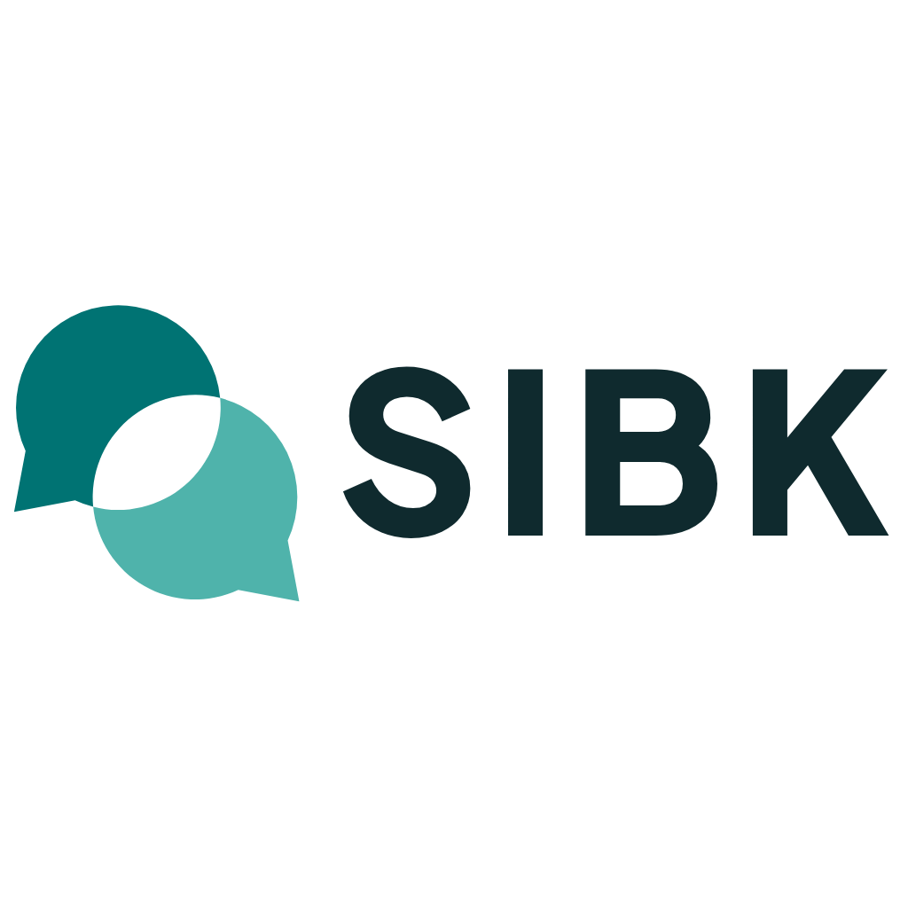

# Panduan Logo SIBK

> Versi 1.0 · 30 Oktober 2026 · Sistem Informasi Bimbingan Konseling SMK IPTEK Tangerang Selatan

## 1. Konsep — "Bertemu"

Dua gelembung percakapan, yaitu **siswa** (kiri, teal tua) dan **Guru BK** (kanan, teal muda), saling bertemu. **Irisan di tengahnya kosong**: itulah ruang aman yang dibagi bersama. Di ruang itu siswa boleh bercerita, bahkan tanpa menyebut nama.

- Dialog dua arah adalah inti sistem: pengaduan dan tanggapan.
- Bentuknya sederhana (dua lingkaran + ekor), tetap terbaca di ukuran 16 px dan dalam satu warna.
- Warna teal dipilih karena terasa **tenang dan dipercaya**, bukan merah/biru khas instansi yang terasa menegur.

Lihat juga: [konsep-logo.png](konsep-logo.png) (tiga konsep awal) dan [board-logo.html](board-logo.html) / [board/](board/) (presentasi + mockup).

## 2. File

| Kebutuhan | File |
|---|---|
| Logo utama (layar, dokumen) | `svg/sibk-horizontal-duotone.svg` |
| Logo bertumpuk (poster, sampul, ruang sempit melebar ke bawah) | `svg/sibk-stacked-duotone.svg` |
| Simbol saja (avatar, stempel digital, ikon) | `svg/sibk-symbol-duotone.svg` |
| Satu warna teal | `svg/sibk-*-teal.svg` |
| Hitam (fotokopi, cetak hitam putih, stempel) | `svg/sibk-*-black.svg` |
| Putih (di atas foto/latar gelap) | `svg/sibk-*-white.svg` |
| Ikon aplikasi (ubin teal) | `svg/sibk-app-icon.svg`, `png/sibk-app-icon.png` |
| Favicon & ikon web/PWA | `web/` (sudah terpasang di `public/` aplikasi) |
| PNG siap pakai (1024 px) | `png/` |

**SVG adalah file master.** PNG hanya untuk aplikasi yang tidak menerima SVG (Word, PowerPoint lama, WhatsApp).

## 3. Warna

| Nama | Peran | HEX | RGB | CMYK (perkiraan) |
|---|---|---|---|---|
| **Teal SIBK** | Gelembung siswa, warna utama aplikasi | `#007373` | 0 115 115 | 100 0 37 55 |
| **Teal Muda** | Gelembung Guru BK | `#4FB3AB` | 79 179 171 | 56 0 4 30 |
| **Teal Malam** | Tulisan "SIBK" | `#0F2A2E` | 15 42 46 | 67 9 0 82 |
| Teal Lembut | Gelembung kanan pada latar teal/gelap | `#A7E0DA` | 167 224 218 | 25 0 3 12 |
| Teal Terang | Gelembung kiri pada mode gelap | `#4AB9B2` | 74 185 178 | 60 0 4 27 |

Nilai CMYK adalah perkiraan. Saat mencetak, cocokkan dengan proof atau buku warna percetakan.

Di aplikasi, warna logo sudah menjadi token CSS (`--logo-1`, `--logo-2`, `--logo-teks`) dan otomatis berganti di mode gelap.

## 4. Tipografi

- **Wordmark "SIBK":** Plus Jakarta Sans ExtraBold (800), sudah diubah menjadi path, jadi file logo tidak membutuhkan font.
- **Teks pendamping** (antarmuka, dokumen): Plus Jakarta Sans Regular–Bold.
- Lisensi: SIL Open Font License, boleh untuk logo dan penggunaan komersial.

## 5. Ruang kosong & ukuran minimum

- **Ruang kosong:** sisakan jarak minimal **x** di sekeliling logo, dengan **x = setengah tinggi huruf "S"** pada wordmark. Untuk simbol saja, x = ¼ lebar simbol. Jangan ada teks, garis, atau tepi kertas di dalam area ini.
- **Ukuran minimum:**
  - Simbol: 16 px (layar) / 6 mm (cetak)
  - Logo horizontal: lebar 96 px / 25 mm
  - Logo bertumpuk: lebar 64 px / 18 mm

## 6. Latar yang diizinkan

| Latar | Versi |
|---|---|
| Putih / abu sangat muda | Duotone (utama) |
| Teal `#007373` | Ubin: gelembung putih + `#A7E0DA` (lihat ikon aplikasi) atau versi putih |
| Gelap / foto gelap | Versi putih, atau duotone mode gelap (`#4AB9B2` + `#A7E0DA`, tulisan `#E9F0F0`) |
| Foto ramai / terang | Letakkan di atas pita putih, jangan langsung di atas foto |

## 7. Jangan

- ❌ Mengubah warna di luar palet, atau membalik urutan warna (kiri harus lebih tua).
- ❌ Mengisi irisan tengah dengan warna apa pun. Irisan harus kosong, karena itulah idenya.
- ❌ Memutar, memiringkan, meregangkan, atau mencerminkan simbol.
- ❌ Memberi bayangan, gradasi, garis tepi, atau efek 3D.
- ❌ Mengganti font "SIBK" atau mengetik ulang dengan font lain.
- ❌ Mengubah jarak atau ukuran relatif simbol dan tulisan pada lockup.
- ❌ Menambahkan ikon lain (hati, tangan, perisai) ke dalam simbol.

## 8. Catatan

- Logo dibuat untuk penelitian skripsi. **Belum ada pengecekan merek dagang.** Sebelum dipakai resmi di luar skripsi, lakukan penelusuran di PDKI (pdki-indonesia.dgip.go.id) dan pencarian gambar terbalik.
- Uji yang sudah dijalankan: audit SVG (simbol 100/100), ukuran 16/24/32/64 px, satu warna, versi terbalik, latar gelap.
